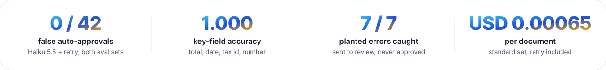
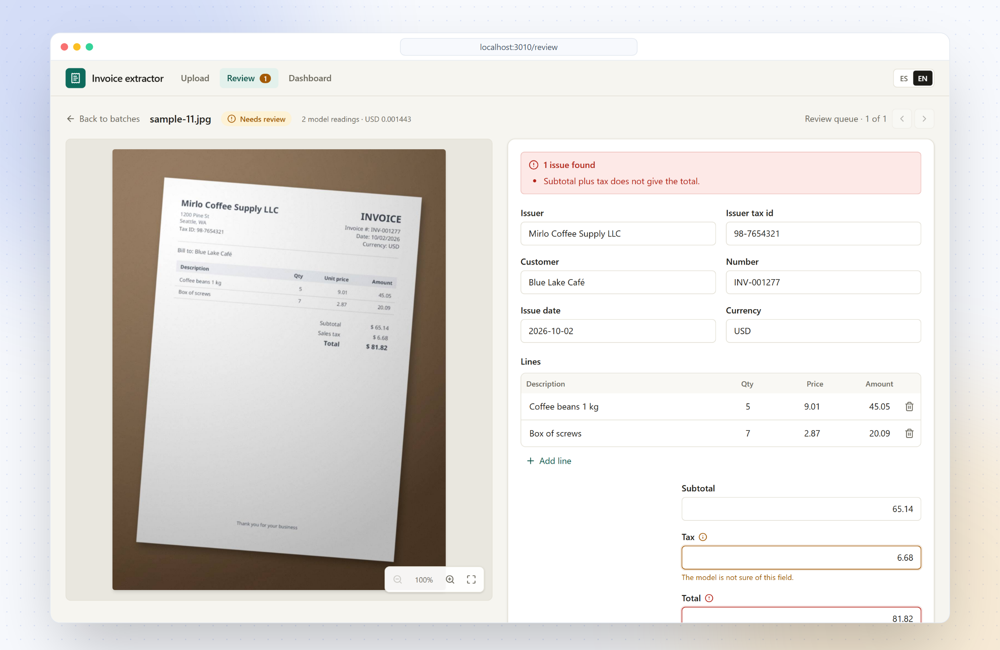
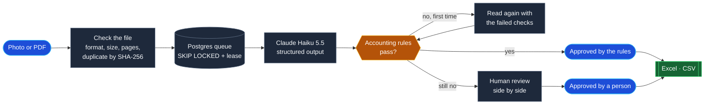

<div align="center">

<picture>
  <source media="(prefers-color-scheme: dark)" srcset="docs/readme/hero-dark.svg">
  
</picture>

<br><br>

<a href="https://github.com/Juxn89/invoice-extractor/actions/workflows/ci.yml"></a>


<a href="LICENSE"></a>

</div>

<br>

<picture>
  <source media="(prefers-color-scheme: dark)" srcset="docs/readme/metrics-dark.svg">
  
</picture>

<br><br>

Small businesses still type invoices into their accounting by hand, and an AI that reads them is only useful
if nobody has to check its work twice. **invoice-extractor** takes photos and PDFs of invoices and receipts,
reads them with Claude Haiku, and checks every reading against deterministic accounting rules: the lines add
up to the subtotal, the tax rate exists in that country, the tax id has its format. What passes goes straight
to an Excel workbook; what does not goes to a person, with the failing field highlighted next to the
original. The model proposes, the rules decide.

> [!NOTE]
> **Built in public, measured in public.** Watch the [70-second demo](docs/demo/demo.mp4) (Spanish captions),
> recorded against the real model: three documents, two approved by the rules, one corrected by a reviewer.
> Every number on this page comes from the evals in [`evals/`](evals/README.md), whose results are
> versioned in [`evals/results`](evals/results), the failures included.

<p align="center">
  <picture>
    <source media="(prefers-color-scheme: dark)" srcset="docs/readme/showcase-dark.png">
    
  </picture>
</p>
<p align="center"><sub>A real reading by Claude Haiku 5.5: the receipt's printed total is wrong, so no rule lets it through. · <a href="docs/demo">all screenshots</a></sub></p>

<p align="center"></p>

## How it works



1. **Upload a batch** of up to 20 PDF, JPG or PNG files and pick the country whose tax rules apply. Each file
   is checked on its own; one already uploaded is recognised by its hash and costs nothing a second time.
2. **Workers read each document** with Claude Haiku 5.5: a digital PDF as its text, a scan as the PDF, a
   photo as an upright JPEG. The answer is constrained to a JSON schema and parsed with exact decimals.
3. **Rules decide.** A reading that breaks a rule is read once more, with the failed checks as feedback. If
   it still fails, or the model says it guessed a key field, a person reviews it. Nothing is ever approved
   on the model's word alone.
4. **Export** what was approved, by the rules or by a person, as an Excel workbook or a CSV.

## What's inside

<table>
  <tr>
    <td width="33%" valign="top">
      <br>
      <b>Reads photos, scans and PDFs</b><br>
      <sub>Text from digital PDFs (PdfPig), vision for the rest; EXIF orientation fixed and images scaled to what the model uses (SkiaSharp).</sub>
    </td>
    <td width="33%" valign="top">
      <br>
      <b>Deterministic accounting rules</b><br>
      <sub>Line arithmetic, lines vs subtotal, subtotal + tax = total, the country's tax rates and tax-id format, plausible dates.</sub>
    </td>
    <td width="33%" valign="top">
      <br>
      <b>One retry, with feedback</b><br>
      <sub>A reading that breaks a rule is read again with the checks it failed. It lifts the hard set's tax-id accuracy from 0.917 to 1.000.</sub>
    </td>
  </tr>
  <tr>
    <td width="33%" valign="top">
      <br>
      <b>Human review, side by side</b><br>
      <sub>The original beside the reading, the failing field in red, the model's doubts in amber; approvals are recorded with their values.</sub>
    </td>
    <td width="33%" valign="top">
      <br>
      <b>A queue in Postgres</b><br>
      <sub><code>FOR UPDATE SKIP LOCKED</code> with a lease: four workers, a hundred documents, each read exactly once, tested.</sub>
    </td>
    <td width="33%" valign="top">
      <br>
      <b>Excel and CSV</b><br>
      <sub>Amounts as numbers, dates as dates, invoices and lines on two sheets; formula injection neutralised in both formats.</sub>
    </td>
  </tr>
  <tr>
    <td width="33%" valign="top">
      <br>
      <b>Evals with pass marks</b><br>
      <sub>42 synthetic documents with planted errors, scored per field; an oracle run in CI keeps the dataset, rules and scorer honest.</sub>
    </td>
    <td width="33%" valign="top">
      <br>
      <b>Cost you can see and cap</b><br>
      <sub>Every call's tokens and price are stored; a dashboard shows cost per document, and a daily budget stops the workers.</sub>
    </td>
    <td width="33%" valign="top">
      <br>
      <b>End to end in CI, for free</b><br>
      <sub>Playwright drives the real API, queue and web app; recorded model answers replace Claude, so CI needs no key.</sub>
    </td>
  </tr>
</table>

## Use it

Needs the .NET 10 SDK, Docker, Node 24 with pnpm, and an Anthropic API key for the workers. Without a key the
app runs and uploads wait in the queue.

```bash
cp .env.template .env                               # put ANTHROPIC_API_KEY in it; .env is git-ignored
set -a; . ./.env; set +a
dotnet run --project src/InvoiceExtractor.AppHost   # Postgres + API through .NET Aspire, API on :5110
cd web && pnpm install && pnpm dev                  # the web app on http://localhost:3010
```

Open http://localhost:3010 and upload a few files from [`evals/samples`](evals/samples), choosing their
country (each one's is in [`manifest.json`](evals/samples/manifest.json)). In Development the workers stop
for the day after USD 0.05.

| Endpoint | What it does |
|---|---|
| `POST /v1/batches` | Upload a batch (multipart, `country` = `NI`, `MX` or `XX`) |
| `GET /v1/batches` · `GET /v1/documents/{id}` | Batches and documents with their status |
| `GET /v1/review-queue` · `GET /v1/documents/{id}/review` | What needs a person, and one reading with its issues |
| `POST /v1/documents/{id}/approve` | Approve, with the reviewer's corrections |
| `GET /v1/export?format=xlsx\|csv&lang=es\|en&batchId=` | The approved invoices |
| `GET /v1/dashboard` | Statuses, auto-approval rate and cost |

Errors are Problem Details with a stable code, listed in [`docs/errors.md`](docs/errors.md).

## Measured, not claimed

Claude Haiku 5.5 (adaptive thinking at `effort: low`, structured outputs) on the synthetic eval sets, 21 Oct
2026, two runs each; the app ships with the retry on. Full tables and what goes wrong are in
[`evals/README.md`](evals/README.md).

| Set | Key fields (total, date, tax id, number) | Auto-approved / false | Planted errors to review | USD per document |
|---|---|---|---|---:|
| Standard, 30 documents | 1.000 each | 25 / 0 | 5 / 5 | 0.000624, 0.000654 |
| Hard, 12 degraded documents, no retry | tax id **0.917** (fails ≥ 0.95), rest 1.000 | 7, 8 / 0 | 2 / 2 | 0.000611, 0.000682 |
| Hard, with retry | 1.000 each | 9, 9 / 0 | 2 / 2 | 0.000972, 0.000971 |

The standard set is easy for the model: clean renders, legible print. The hard set is scans at 100 dpi,
keystoned photos, faded thermal receipts and a PAID stamp over the lines, plus the customer's tax id printed
next to the issuer's. Without the retry it misses the pass mark; with it, it passes. In no run is a wrong
reading approved: what goes wrong is always caught by a rule.

```bash
dotnet run --project evals/InvoiceExtractor.Evals -- run oracle                             # free, runs in CI
dotnet run --project evals/InvoiceExtractor.Evals -- run claude --allow-paid [--set hard]   # paid, budget-guarded
```

The demo batch (one PDF, one scan, one photo) cost USD 0.0024 for four calls, one of them the retry.

## Architecture

```
src/
  InvoiceExtractor.Domain          invoice, documents and their lifecycle, validator, country tax profiles
  InvoiceExtractor.Application     use cases (upload, process, review, export, dashboard) and their ports
  InvoiceExtractor.Infrastructure  EF Core + Postgres, the queue and workers, Claude, PdfPig, SkiaSharp, ClosedXML
  InvoiceExtractor.Api             Minimal API endpoints, the composition root
  InvoiceExtractor.AppHost         .NET Aspire: Postgres 18 and the API
web/                               Next.js 16 front end, Spanish and English; Playwright E2E and the demo recorder
evals/                             dataset generator, scorer, thresholds and versioned results
tests/                             domain, application, architecture (ArchUnitNET), integration (Testcontainers)
```

The dependency rule, `Domain ← Application ← Infrastructure ← Api`, is enforced by architecture tests. Amounts
are `decimal` from the model's answer to the spreadsheet: the schema asks for decimal strings, never JSON
numbers.

## Decisions

| Decision | Why | Trade-off |
|---|---|---|
| **The model proposes, rules decide** | A language model is sometimes confidently wrong; arithmetic and formats can be checked without it | Rules catch inconsistency, not every misreading: a wrong value that still adds up passes. The evals count those: none so far |
| **One retry with the failed checks** ([ADR 0002](docs/adr/0002-retry-with-validation-feedback.md)) | Most misreadings are a digit or a letter; told what failed, the model fixes them | About +50 % cost on hard documents, and planted errors are paid for twice before they reach a person |
| **Queue in Postgres, not a broker** ([ADR 0003](docs/adr/0003-queue-in-postgres.md)) | `SKIP LOCKED` and a lease give exactly-once processing with the database the app already has | Polling, and a throughput ceiling far above what an accounting office uploads |
| **Haiku 5.5 for every call** | The task is reading printed fields; the evals pass at USD 0.0006–0.001 per document | A stronger model might read the worst photos better; the review queue covers them instead |
| **Recorded answers for E2E** | The whole app runs in CI without a key or a bill | The recordings test the pipeline, not the model; the paid evals do that |

## Development

```bash
dotnet build                                   # warnings are errors
dotnet test                                    # 166 tests: unit, architecture and integration (needs Docker)
dotnet format whitespace --verify-no-changes

cd web
pnpm lint && pnpm typecheck
pnpm e2e:db && pnpm e2e                        # end to end on recorded answers: no key, no cost
ANTHROPIC_API_KEY=... pnpm demo                # re-records docs/demo with the real model (~USD 0.0025)
node scripts/readme-assets.mjs                 # README artwork in docs/readme
```

CI runs all of it on every push except the paid runs: build, format, tests, the oracle evals, the web app's
lint, types and build, and the Playwright test against Postgres.

## How it was built

With Claude Code, against the rules in [`AGENTS.md`](AGENTS.md) (versions at least two weeks old, OSI licences
only, the dependency rule, no magic strings or numbers), which `CLAUDE.md` imports. Pull requests are reviewed
by [claude-pr-review-bot](https://github.com/Juxn89/claude-pr-review-bot), my own GitHub Action
([`.github/workflows/review.yml`](.github/workflows/review.yml)). Every paid model call, the evals and the
demo included, runs under a spending cap. Where the tax rules come from is documented in
[`docs/verification/tax-rules.md`](docs/verification/tax-rules.md).

<p align="center"></p>

<div align="center">

**Juan Gómez** · [juangomezb.com](https://www.juangomezb.com) · [GitHub](https://github.com/Juxn89) · [LinkedIn](https://www.linkedin.com/in/jcgomez89/)

<sub>Released under the <a href="LICENSE">MIT License</a>.</sub>

</div>
